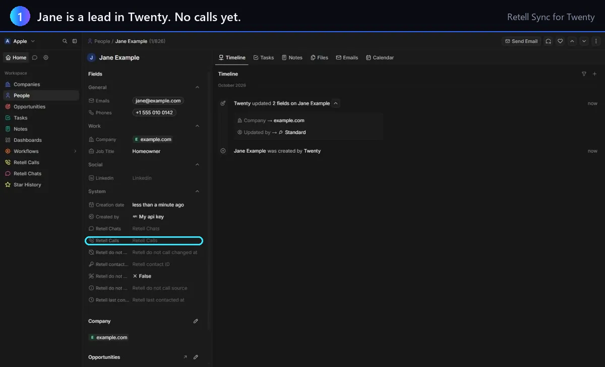
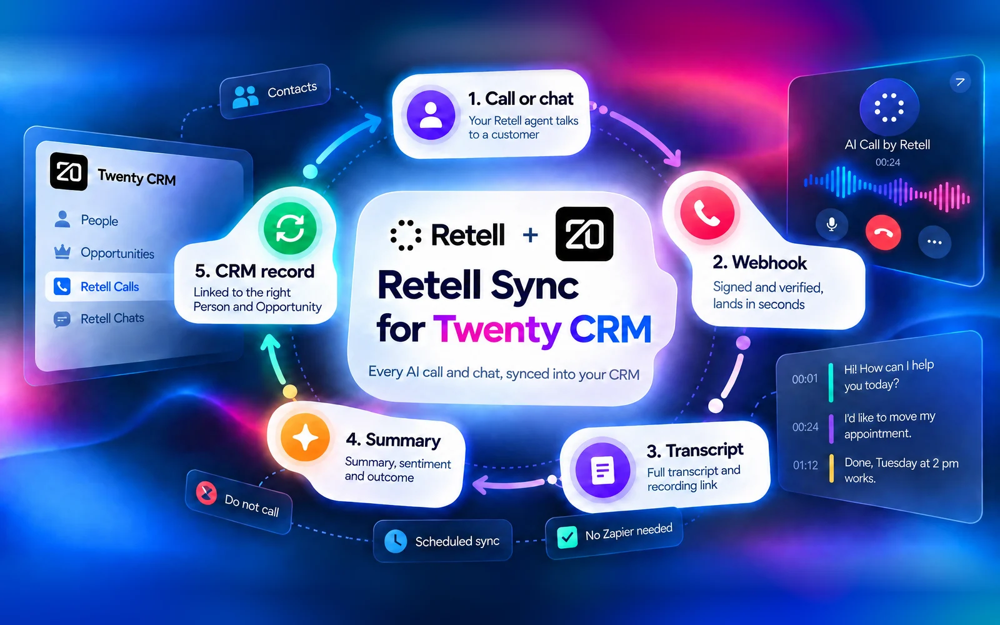
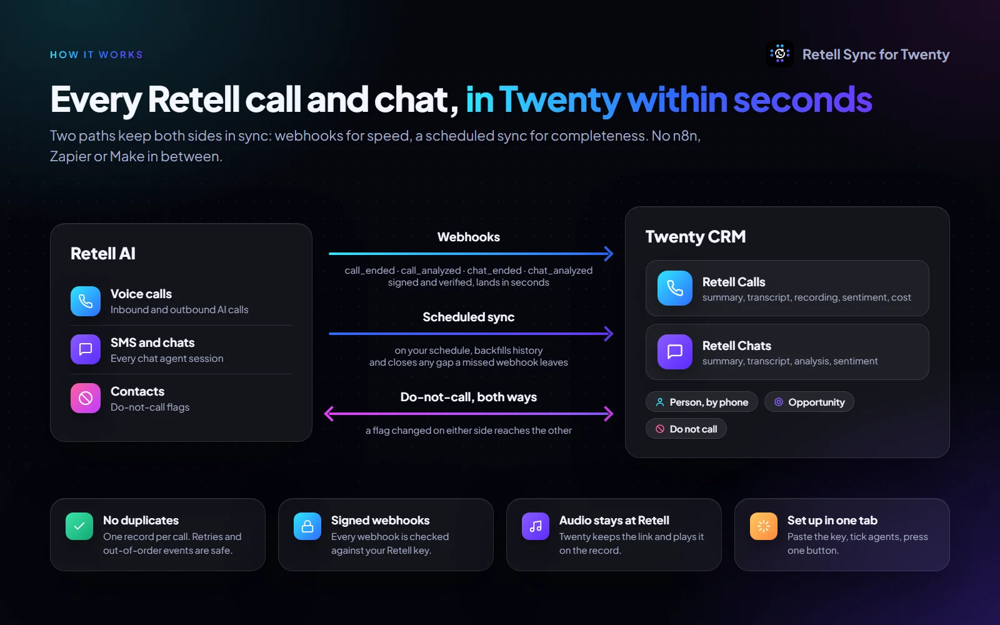
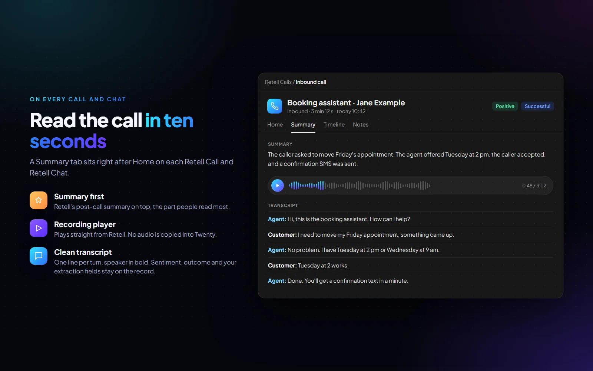
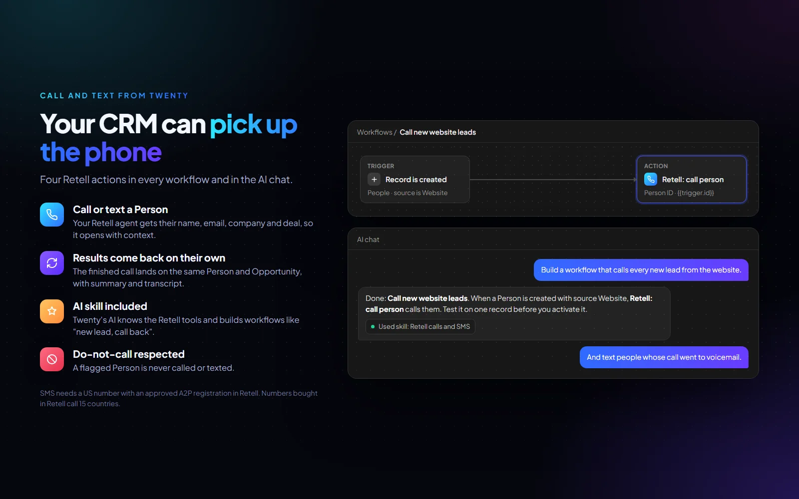
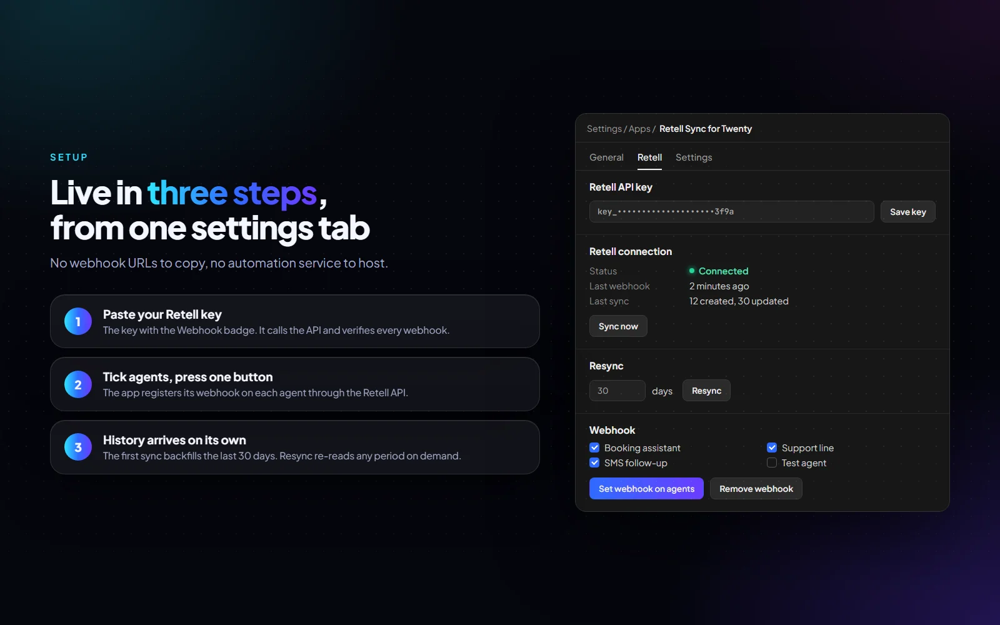
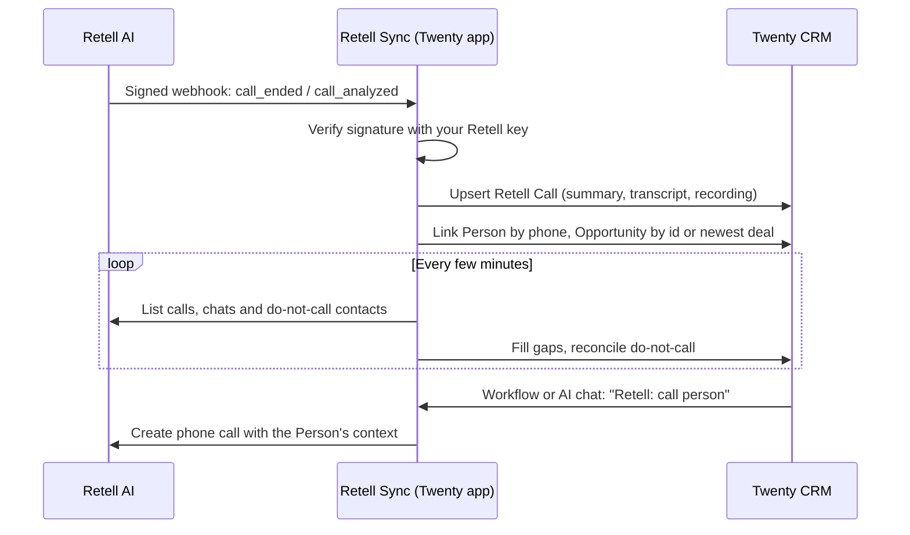

<div align="center">
  
  <h1>Retell Sync for Twenty</h1>
  <p><strong>Every Retell AI call and SMS chat in your Twenty CRM within seconds. Call or text a Person from a workflow or the AI chat.</strong></p>
  <p>
    <a href="#installation"> Install</a> ·
    <a href="../README.md"> Full guide</a> ·
    <a href="https://github.com/MikiDevStudio/twenty-retell-sync/issues"> Issues</a> ·
    <a href="../LICENSE"> MIT license</a>
  </p>
  <p>
    <a href="../package.json"></a>
    <a href="../LICENSE"></a>
    <a href="https://twenty.com"></a>
    <a href="https://www.retellai.com"></a>
  </p>
</div>

<p align="center">
  
</p>

<details>
<summary><strong>Overview</strong> · the whole flow on one picture</summary>
<br/>

<p align="center">
  
</p>

</details>

<br />

# Why Retell Sync

Teams that run voice and SMS agents on [Retell AI](https://www.retellai.com) and keep customers in [Twenty](https://twenty.com) usually
glue the two together with an automation service: one more account, one more bill, and one more place where a call gets lost.
Retell Sync is a Twenty app that talks to both APIs directly. Install it, paste your Retell key, and calls and chats arrive in
Twenty as records, linked to the right Person and Opportunity.

<br />

# Everything you need

| Sync | Act | Control |
| :--- | :--- | :--- |
| Calls and chats as Twenty records | Call a Person from a workflow | One settings tab, no URLs to copy |
| Summary, transcript, recording | Start an SMS chat with a Person | Resync any period on demand |
| Linked to Person and Opportunity | AI chat tools and a Retell skill | Do-not-call in sync both ways |

<table align="center">
  <tr>
    <td width="50%">
      
      <p align="center"> Webhooks in seconds, a scheduled sync for every gap</p>
    </td>
    <td width="50%">
      
      <p align="center"> A Summary tab on every call and chat</p>
    </td>
  </tr>
  <tr>
    <td width="50%">
      
      <p align="center"> Call and text from workflows and the AI chat</p>
    </td>
    <td width="50%">
      
      <p align="center"> Set up in one settings tab</p>
    </td>
  </tr>
</table>

- **Calls and chats as records:** summary, transcript, recording link, sentiment, outcome, cost and your own post-call fields.
- **Linked to your CRM:** each call finds its Person by phone number and, when it can tell, its Opportunity.
- **Call and text from Twenty:** four actions (call person, send SMS, refresh call, set do-not-call), each a workflow step and an
  AI tool, plus a skill that teaches Twenty's AI to use them.
- **Do-not-call in sync:** a caller who asks not to be called again is flagged on their Person; a flag set in Twenty goes to Retell.
- **Nothing lost:** retries and out-of-order events are safe, one record per call, a filled field is never blanked.

<br />

# How it works



<br />

# Installation

1. **Allow logic functions** on your Twenty server (`LOGIC_FUNCTION_TYPE=LOCAL` or `LAMBDA`; production defaults to `DISABLED`).
2. **Install the app** in your workspace. Until it is listed on the Twenty marketplace, deploy it from source:
   ```bash
   yarn install
   yarn twenty remote:add --url https://your-twenty-server --api-key <key> --as server
   yarn twenty app:publish --private -r server && yarn twenty app:install -r server
   ```
3. **Paste your Retell key** in Settings > Apps > Retell Sync for Twenty > Retell. Use the key with the *Webhook* badge.
4. **Tick your agents** and press **Set webhook on agents**. The first sync loads the last 30 days.

Everything else (the Retell tab, do-not-call rules, opportunity linking, workflow recipes, limits) is in the [full guide](../README.md).

<br />

# Good to know

- Audio stays at Retell: Twenty stores only the recording link.
- SMS needs a US number with an approved A2P registration in Retell. Numbers bought in Retell call 15 countries.
- The AI chat is told to propose every call and SMS for approval. That is an instruction to the model, not a hard lock, so test
  calling workflows on one record first.

<br />

# Development

Requires Node 24 and Yarn 4. `yarn twenty docker:start` runs a local Twenty, `yarn twenty apply` syncs the app, `yarn test:unit`
runs the unit tests. The code map and project rules are in [AGENTS.md](../AGENTS.md).

<br />

<sub>An independent app by MikiDev Studio, released under the MIT license. Not affiliated with or endorsed by Retell AI or Twenty.
Retell and Twenty are trademarks of their owners, used here only to name the services this app connects.</sub>
